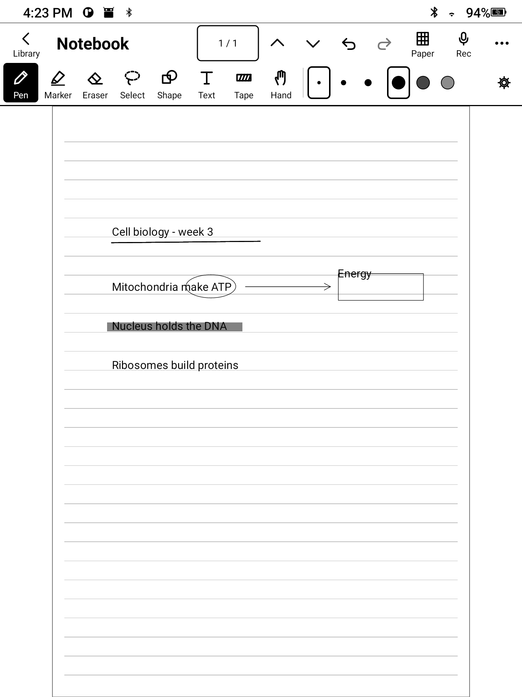
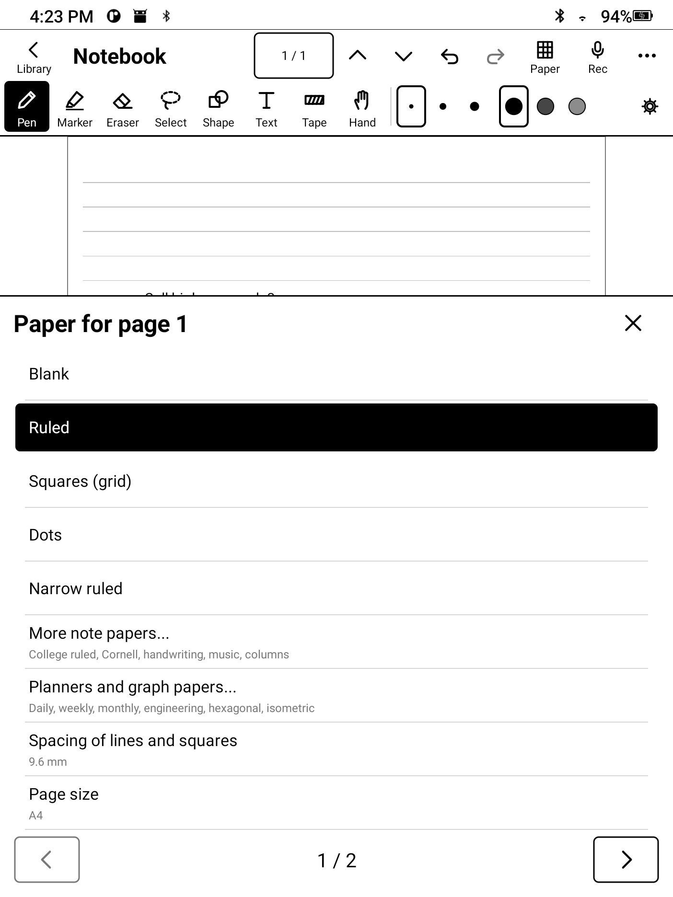
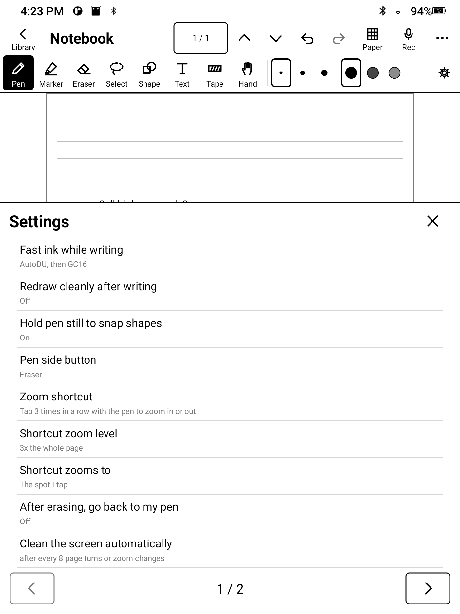

# Ink Notes

**Handwritten notes, PDF study and an ebook reader, built for e-ink tablets.**

No animations, no ghosting-prone effects, no account, no cloud. Your pen, your pages, your device.

[**Download the APK**](../../releases/latest) · [Privacy](PRIVACY.md) · [Roadmap](ROADMAP.md)

  
  
  

Captured on the Hanvon N10. Large targets, no animation, one refresh per action.

## Why

Most note apps assume an LCD that redraws sixty times a second. On an e-ink screen that means smearing, flashing and a pen that lags. Ink Notes is written from the first line for slow panels: one clean refresh per action, fast ink mode while you write, a full-quality redraw when you stop.

## Features

**Write**
- Pressure pen, calligraphy nib, marker that snaps to PDF text lines, whole or partial eraser, lasso, text boxes, tape, ruler, hand tool
- Hold the pen still and a rough line, arrow, circle, rectangle or triangle snaps clean
- Triple-tap zoom: tap three times with the pen and the page zooms right there; lift near the edge and it slides along
- Paper: ruled, college, grid, dots, Cornell, music staves, planners, engineering, hexagonal, isometric; A4 / Letter / Legal and more
- Undo/redo, folders, favourites, Recently deleted (30 days), `.inkz` backup and restore

**Study**
- Import PDFs, find text, outline, select and highlight text, export a PDF with your ink
- Record audio while you write; strokes link to the sound and replay with it
- Optional AI with **your own key** (Gemini, OpenAI, Anthropic, OpenRouter): ask about a page, summaries, flashcards and quiz, audio transcripts

**Read**
- EPUB, PDF, FB2, TXT, HTML, CBZ comics and MOBI
- Tap a word for an offline English and Turkish dictionary; highlights, notes, AI translation and summaries

## Install

1. On your tablet open the [latest release](../../releases/latest) and download `ink-notes.apk`.
2. Open it. If Android asks, allow installing apps from your browser or file manager.
3. Launch **Ink Notes**.

Requires Android 9 or newer. Built and tested on the Hanvon N10 / Penstar eNote (Android 11, pen only). It should work on other Android e-ink tablets; reports are welcome.

Verify the download (optional):

    shasum -a 256 ink-notes.apk     # compare with SHA256SUMS.txt on the release page

## Privacy and safety

No account, no analytics, no ads. Everything stays on the tablet. The only network use is the optional AI feature, which sends what you choose straight to the provider you configured with your own key. This repository contains no keys or secrets. Details: [PRIVACY.md](PRIVACY.md), [SECURITY.md](SECURITY.md).

## Build from source

You need a JDK 17+ and the Android SDK (API 34). Then:

    git clone https://github.com/AngerDileklen/ink-notes.git
    cd ink-notes
    echo "sdk.dir=/path/to/Android/sdk" > local.properties
    ./gradlew :app:assembleDebug            # app/build/outputs/apk/debug/app-debug.apk
    ./gradlew :app:testDebugUnitTest        # unit tests

`bash scripts/build.sh` does the same and copies the APK to `dist/`; `scripts/env.sh` can point at a toolchain on an external drive (`INK_TOOLCHAIN`).

The offline dictionary (`dict.db`) is not stored in git. Without it the app builds and runs, but word lookup is empty. Build it from the free data sets listed in `scripts/build_dict.py`:

    python3 scripts/build_dict.py /path/to/dict-src

Signed release: copy `keystore.properties.example` to `keystore.properties`, fill in your own keystore, run `bash scripts/build.sh release`.

For USB testing, debug builds accept `adb shell am broadcast -a app.einknotes.DEBUG --es cmd <command>` (see `NotesActivity.registerDebugControl`). These hooks are absent from release builds.

## Related

**[Ink Drop](https://github.com/AngerDileklen/ink-drop)** sends files between the tablet, a Mac and an iPhone over Bluetooth plus a private Wi-Fi link, with no shared network. Books it receives show up in Ink Notes automatically.

## Contributing

Pull requests and bug reports are welcome. See [CONTRIBUTING.md](CONTRIBUTING.md). Third-party components: [NOTICE.md](NOTICE.md).

## License

[MIT](LICENSE). Not affiliated with Notability, Hanvon, Penstar or Google.
